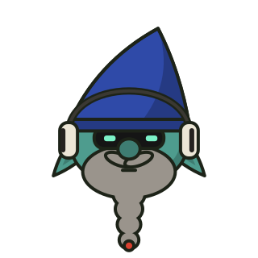

<p align="center"></p>

<h1 align="center">Goblins</h1>

<p align="center">A clan of 3D goblin avatars with gnome hats, beards and fifteen animated moods.<br/>Flat toon colors, ink outlines, no gradients. Export to SVG, PNG, JSON or a React component.</p>

---

## What's inside

- **Studio** (`studio.html`): dress a clan of goblins in 3D. Click one for a close-up, pinch or scroll out to see everyone, drag to spin. Export from the side panel.
- **Home** (`index.html`): a floating island with a stone path, lamps, flowers, mushrooms and trees, where the goblins live.
- **Docs** (`docs.html`) and **Changelog** (`changelog.html`).
- **Classic** (`goblins.html`): the original single-file version. Open it straight in a browser, no build needed.

## Run it

```sh
bun install
bun run dev      # http://localhost:5173
bun run build    # static site in dist/
```

## Use a goblin in React

```tsx
import { GoblinAvatar, Goblin3D, DEFAULT_CLAN } from "./src/goblin";

const bramble = DEFAULT_CLAN[2];

<GoblinAvatar goblin={bramble} expression="wink" size={64} />   // flat SVG, cheap
<Goblin3D goblin={bramble} expression="searching" size={320} /> // animated WebGL
```

Or export a goblin from the studio as a single `.tsx` file with every expression built in and no dependencies:

```tsx
import { Bramble } from "./Bramble";

<Bramble expression="thinking" size={48} />
```

## Exports

| Format | Function | Output |
| --- | --- | --- |
| SVG | `toSVG(goblin)` | Flat front-facing sticker in the current expression |
| PNG | `toPNG(goblin, 1024)` | Transparent PNG blob (browser) |
| JSON | `toJSON(goblin \| goblin[])` / `fromJSON(text)` | `goblins/v1` recipe file |
| React | `toReact(goblin)` | Self-contained `.tsx` component |

## Traits

Skin · head (round, egg, wide, bean) · ears (pointy, round, droopy, long, tiny) · nose (bulb, button, long, hook) · eyes (round, oval, wonky, beady, visor) · hat (gnome, wizard, beret, beanie, mushroom, sprout, headband) · beard (full, pointy, forked, braid) · eyewear (round, shades, monocle) · scarf (wrap, long) · extras (headphones, earring, pipe, tusks, freckles).

## Expressions

`idle` `happy` `laughing` `love` `wink` `surprised` `thinking` `searching` `confused` `nervous` `sad` `angry` `talking` `sleeping` `celebrate`

Each one sets a face pose (eyes, lids, brows, mouth) and a motion for the head, hands and props: thought bubbles, a magnifying glass, Z's, hearts, a tear.

## Layout

```
src/goblin/   the library: traits, 3D rig, expressions, SVG renderer, exporters, React components
src/studio/   the studio app
src/site/     nav, footer, logo, scenery, the 3D island
src/pages/    home, studio, docs, changelog entry points
```

## Credits

Inspired by [Bible Strong avatars](https://avatars.bible-strong.app/) for the 3D look, [open-bot-avatar](https://github.com/DominikScholz/open-bot-avatar) for the bot visor, and the Mipmapp characters for the floating mitts.

## License

[MIT](LICENSE)
